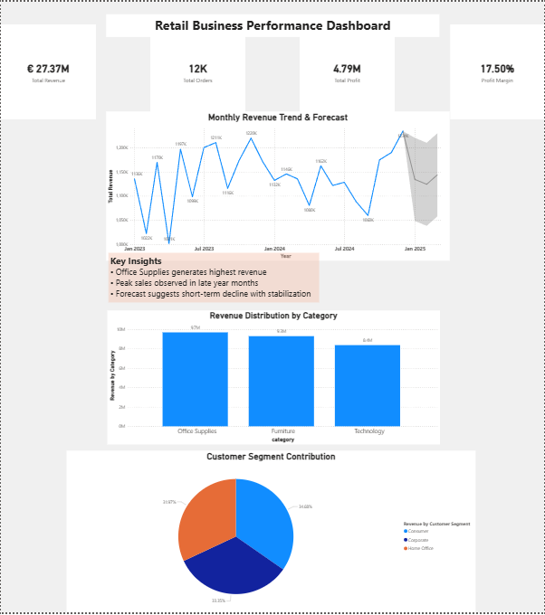
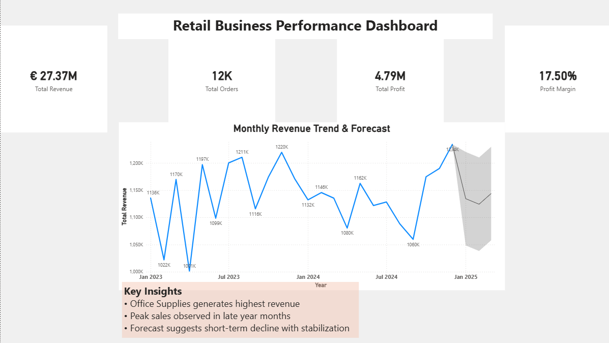
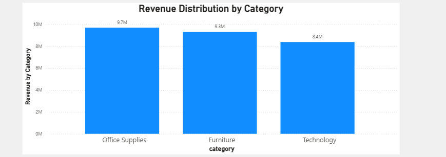
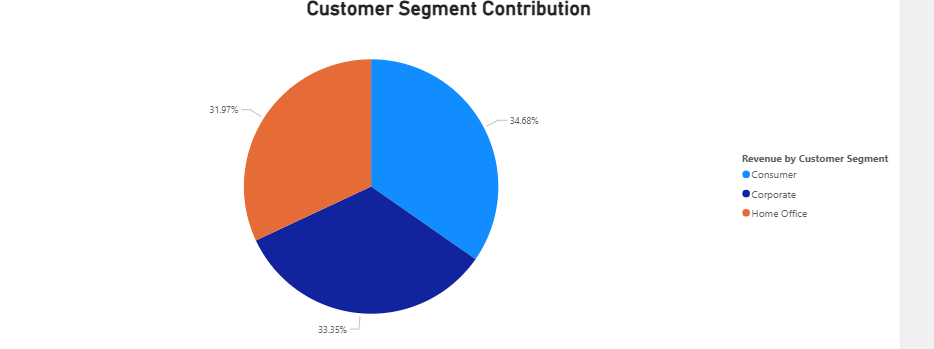

# Retail Sales Analytics Dashboard

An academic business-intelligence project combining PostgreSQL queries and a Power BI report to explore retail sales performance.

## Analysis areas

- Revenue, profit, order count, and profit margin.
- Monthly revenue trends and forecasting views.
- Revenue by product category.
- Customer-segment contributions.

## Repository guide

| File or folder | Purpose |
| --- | --- |
| [Retail-Sales-Dashboard.pbix](Retail-Sales-Dashboard.pbix) | Power BI report |
| [Sales_project.sql](Sales_project.sql) | Table definitions and example analysis queries |
| [Data](Data/) | Customers, products, regions, and sales CSV files |
| [Images](Images/) | Dashboard and individual chart previews |

## Explore the report

1. Download the repository and open the PBIX file in Power BI Desktop.
2. Inspect its data-source settings and update local paths or database connections as needed.
3. Refresh the report and review its relationships and measures before interpreting results.

To reproduce the SQL analysis, create a practice PostgreSQL database, run the table definitions in `Sales_project.sql`, and import the four CSVs into their matching tables. The script defines tables and queries; it does not include CSV-loading commands. Load the data before running the analysis queries.

## Interpretation

The report supports descriptive analysis of the supplied dataset. Forecasts depend on the historical series and report settings; they are not validated business commitments. Refreshing or changing filters can change the displayed totals.

### Additional previews

